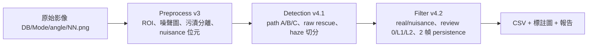

# Grok-AOI

半導體表面光學潔淨度自動光學檢測（AOI）。一條指令跑完 preprocess v3、detection v4.1、filter v4.2，並寫出 CSV、標註圖與繁體中文報告。

演算法與門檻沿用研究腳本，這次是包裝成可安裝的程式：路徑由參數傳入，資料庫可以只含部分模式或角度。

## 系統做什麼

明場（Edge1、Edge2）找暗缺陷，暗場（Side）找亮缺陷。ROI 只排除治具與真正的外邊界；反光、照明不均、粗糙、水痕、油膜、載體墨跡留在 ROI 裡，標成干擾區（nuisance）供複檢，不直接丟棄。跨過 ROI 邊界的點保留。靈敏度包含淡灰點。

每顆候選最後是 `real`（落塵 particle／髒污 stain／刮傷 scratch）或 `nuisance`，並帶複檢等級 0、L1 或 L2。

## Pipeline



相鄰幀有重疊（Edge 步距約 1940 px，約 116 列重疊；Side 橫向位移約 2262 px），filter 用這個重疊做 2 幀 persistence。樣本至少要有連續的兩張（例如 `01.png` 與 `02.png`）persistence 才測得到。

## Installation

研究環境是 Python 3.13.5。這個套件在 **Python 3.12 與 3.13** 上使用同一組函式庫版本（見 `requirements.txt`）。

```bash
python3 -m venv .venv
source .venv/bin/activate
pip install -r requirements.txt
pip install -e .
```

`pip install -e .` 之後可以用主控台指令 `grok-aoi`，效果與 `python grok_aoi.py` 相同。

## 輸入資料庫

```
<DB>/<Mode>/<angle>/NN.png
```

| 模式 | 光學 | 角度 | 參考資料的幀數 |
|---|---|---|---|
| Edge1、Edge2 | 明場 bright-field | 000、090 | 每個資料夾 46 張（00–45） |
| Side | 暗場 dark-field | 000、090、180、270 | 每個資料夾 16 張（00–15） |

影像是 8-bit 灰階 PNG。參考機台為 2464×2056；其他尺寸會用實際寬高做邊界檢查，persistence 的 NCC 視窗會按比例縮放，不會因為尺寸不同就中斷。幀數不寫死：目錄裡有幾張 `NN.png` 就處理幾張。可以只有部分模式或角度，例如只有 `Edge1/000` 與 `Side/000`。

`NN` 是至少兩位數的幀號（`01.png`）。程式只讀檔名全是數字的 PNG，不會把前處理產物誤當輸入。

## 如何執行

```bash
python grok_aoi.py --db /data/aoi_db --out /data/aoi_run --nproc 4
```

只跑兩個資料夾，並在做完後補代理評測：

```bash
python grok_aoi.py --db tests/fixtures --out /tmp/aoi_sample \
  --folders Edge1/000 Side/000 --nproc 2 --with-eval
```

中斷後從已完成的階段接著做（資料庫、資料夾與設定檔必須和上次相同）：

```bash
python grok_aoi.py --db /data/aoi_db --out /data/aoi_run --resume
```

安裝後也可以：

```bash
grok-aoi --db /data/aoi_db --out /data/aoi_run
```

各階段會寫到終端機，並追加到 `<out>/logs/run.log`。

## CLI options

| 參數 | 說明 |
|---|---|
| `--db` | 影像資料庫根目錄（必填） |
| `--out` | 輸出目錄（必填，不存在會建立）。不可放在 `--db` 裡面 |
| `--folders` | 子集，空白分隔。`Edge1/000` 或 `Edge1_000` 都可以。省略則處理資料庫裡每一個模式／角度 |
| `--nproc` | 偵測與標註圖的程序數。預設 `min(4, CPU)` |
| `--config` | 資料集設定（異常幀、e_strip、Willson 標籤）。預設 `grok_aoi/configs/dataset.yaml` |
| `--preprocess-config` | preprocess v3 的演算法設定。預設 `grok_aoi/configs/preprocess_v3.yaml` |
| `--with-eval` | 額外做代理評測（THR=12 保留率、polarity-flip 假 real 估計）。會再跑一次翻轉極性的偵測 |
| `--skip-eval` | 不做代理評測。這是預設 |
| `--resume` | 若同一組 db／資料夾／設定已經跑完某階段，就跳過該階段 |
| `--legacy-v31-decisions` | 舊版 filter v3.1 的決策目錄，用來打開 Side T2 的規則 (b)。見下方說明 |
| `--glare-bands` | Side 反光橫帶 JSON。預設使用套件內的參考檔 |

## 輸出目錄

```
<out>/
  logs/run.log
  config/dataset.yaml
  config/preprocess_v3.yaml      # 這次實際使用的前處理設定（已套上資料集標籤）
  config/run_meta.json           # 路徑、資料夾、各階段秒數
  preprocess/<Mode>/<angle>/
      NN_cleaned.png NN_mask.png NN_nuisance.png NN_noise.png NN_stain.png
      report.json
  detect/{edge|side}/<Mode>_<angle>/
      candidates.csv  NN_candidates.json  summary.json
      masks/  suppressed_bands.json  suppressed_lines.json
  filter/work/                   # M.pkl、persist_*.pkl、reg_*.json、D_final.pkl（中間檔）
  filter/{edge|side}/<Mode>_<angle>/
      decisions.csv  decisions.json
      defects.csv    defects.json
      summary.json   overlay_<folder>_<frame>.png
  filter/summary.json
  filter/oil_film_c20_review_list.csv
  final/final_defects.csv            # 每一顆 real 候選
  final/final_defects_unique.csv     # 跨幀合併後的缺陷
  final/defects_per_frame.csv
  final/overlays/<folder>/NN.jpg
  final/overlays/<folder>/contact_sheet.jpg
  report/report.html
  report/report.md
  report/summary.json
  report/l2_priority.csv
  eval/metrics.json              # 只有 --with-eval
  eval/detect_flip/              # 翻轉極性的偵測輸出
```

### final_defects.csv

每一列是一顆 **real** 候選。

| 欄位 | 意義 |
|---|---|
| candidate_id | 候選 ID，例如 `Edge1_000_01_c0007` |
| defect_id | 跨幀合併後的缺陷 ID；空字串表示沒有併入 |
| folder, frame, image | 資料夾、幀號、原圖路徑 |
| bbox_x, bbox_y, bbox_w, bbox_h | 原圖像素的外接框 |
| area_px, contrast, cnr, snr_raw | 面積與對比（contrast 負值＝暗缺陷） |
| class | 固定為 `defect` |
| subclass, subclass_zh | particle／stain／scratch 與中文（落塵／髒污／刮傷） |
| review_required, review_level, review_label | 是否複檢；等級 0／1／2；標籤 none／L1／L2 |
| tier | 偵測端的 tier prior（T1／T2／T3） |
| zone | normal、uneven、specular、rough、oil、water、ink |
| reason_code, reason | 規則碼與說明 |
| same_object_group, same_object_n, same_object_n_real | 同幀、同極性、框距離 ≤2 px 的連通群。**不是缺陷個數** |
| anomaly_frame | 是否為設定裡的異常幀 |
| pers_tested, pers_confirmed | 2 幀 persistence 是否測得到、是否被相鄰正常幀確認 |

### final_defects_unique.csv

跨相鄰幀、位置對得上的 real 候選合併成一列。主要欄位：`defect_id`、`fine_class`、`fine_class_zh`、`rep_frame`、`rep_image`、`rep_candidate_id`、`bbox_*`、`area_px`、`contrast`、`snr_raw`、`region`、`n_candidates`、`n_frames`、`frames`、`candidate_ids`、`review_required`、`review_level`、`review_label`、`tier`、`all_in_anomaly_frames`、`persistence_confirmed`、`folder`。

### defects_per_frame.csv

每一列一個（資料夾, 幀）。欄位：`folder`、`frame`、`anomaly_frame`、`candidates`、`real`、`nuisance`、`real_no_review`、`real_L1`、`real_L2`、`nuisance_review_L1`、`nuisance_review_L2`，以及 `particle`／`stain`／`scratch` 與其 `_L1`、`_L2`。只有「至少一顆候選」的幀會出現。

### decisions.csv（filter 階段，含 nuisance）

比 `final_defects.csv` 多了被判成 nuisance 的候選，以及 `decision`、`fine_class`（nuisance 時可能是 noise、texture、oil_film、water_mark、edge_artifact、reflection）、`region`、`rim_dist_px`、`glare_row`、`defect_id`、`det_path`、`consolidation` 等。`filter/summary.json` 是整次 filter 的彙總，含 Side T2 規則 (a)(b) 的筆數。

### 標註圖

`final/overlays/<folder>/<frame>.jpg` 是 0.5 倍原圖加上 real 框：

- 綠＝落塵 particle，橙＝髒污 stain，藍＝刮傷 scratch
- 實線＝review 0，虛線＝L1，粗框加白暈＝L2
- 洋紅輪廓＝ROI（來自 preprocess 的 `*_mask.png`）
- 小於 6 px 的框以 6 px 繪製

每個資料夾另有 `contact_sheet.jpg`。filter 目錄裡的 `overlay_*.png` 是單幀預覽（含少量 nuisance 角標），不是最終交付圖。

### 報告

`report/report.html` 是自包含的繁體中文頁面（技術名詞可保留英文），並有 `report.md` 與 `report/summary.json`。內容來自**這次執行**：執行資訊與設定、各模式／角度／幀的類別與複檢計數、nuisance 區域、L2 優先清單（完整 CSV 在 `l2_priority.csv`）、標註圖連結。有加 `--with-eval` 時才會放入保留率與 flip 估計。

## Review levels 與 nuisance bits

| 等級 | 意義 | 圖上 |
|---|---|---|
| 0 | real，不需複檢 | 實線 |
| L1 | 需要看過 | 虛線 |
| L2 | 優先複檢 | 粗框＋白暈 |

Nuisance 不是刪除。`NN_nuisance.png` 的像素值是下列位元的和，可以重疊；0 表示 ROI 外或沒有旗標。

| bit | 名稱 | 說明 |
|---|---|---|
| 1 | specular | 鏡面反光 |
| 2 | uneven | 照明不均 |
| 4 | rough | 粗糙 |
| 8 | water | 水痕 |
| 16 | oil | 油膜 |
| 32 | ink | 載體墨跡（slide ink） |

## Config

兩個檔，都是 YAML。

`grok_aoi/configs/preprocess_v3.yaml` 是前處理演算法（ROI、去噪、污漬分離、各區門檻）。`safety.protected_out_roots` 預設是空的，所以輸出可以放在任意目錄。`safety.max_files_without_flag` 仍是 24；主程式一律以「整夾確認」的方式呼叫，不需要再加 `--all`。

`grok_aoi/configs/dataset.yaml` 是**這批參考資料**的設定，換資料時複製一份再改：

- `image.width` / `image.height`：參考尺寸 2464×2056。實際影像不同時，程式用讀到的尺寸，不中斷。
- `anomaly_frames`：Edge `{0, 45}`、Side `{0, 15}`。這些幀不能只靠自己變成 real，要在相鄰的正常幀被 persistence 確認；否則是 `N_ANOM_UNVERIFIED`（nuisance，需複檢）。參考幀數寫在 `reference_frame_counts`，**只是說明，不會拿來斷言**。
- `e_strip`：Side_270 第 15 幀、x 1380–1500、y 780–1460、面積 <200 的暗帶碎點（前處理假影）。其他資料請設 `enabled: false`。
- `preprocess_labels`：Willson 的幀級確認標籤（油膜、水痕、治具）。沒有該幀就略過。整份換成 `{}` 表示沒有人工確認標籤。
- `overlay_exemplar`：filter 預覽圖優先用的幀（參考資料是 Edge2_090 的第 27 幀）。該幀不存在就改自動選。
- `highlight_ids`、`stain_id`：摘要裡點名的候選。資料裡沒有就記成空清單，不會失敗。
- `legacy_rule_b`：說明用。真正打開規則 (b) 的是 CLI `--legacy-v31-decisions`。

候選總數（舊腳本的 `NEXP`）改由這次偵測結果計算，並檢查每個 ID 恰好出現一次。不再對一個固定數字做斷言。

## 已知限制

- **Edge1/090** 在原始全庫評測裡是最弱的資料夾（淡點、油紋多）。這是資料特性，不是這次包裝改掉的。
- 油膜與粗糙區裡的淡灰點，多半是在 **filter** 被標成 nuisance（並標複檢），不是偵測階段沒看到。
- 油紋上的纖維會被切成一串框。`same_object_n` 在 oil／rough 區是叢集大小，**不要當成缺陷數**。乾淨區、群組很小的時候才適合拿來合併碎片。
- **Side T2 規則 (b) 預設關閉。** 規則 (a) 仍在：persistence 測得到但沒被確認的 Side T2 real，會轉成 nuisance＋L2（`N_SIDE_T2_UNCONFIRMED`）。規則 (b) 還要看舊版 v3.1 filter 的空間對應（v4 新增、且 persistence 測不到）。原始全庫 541 筆 Side 轉換裡約 205 筆來自規則 (b)。沒有 v3.1 決策檔時無法重現那 205 筆，所以預設只做規則 (a)，新鮮資料庫不必先跑 v3.1。若要規則 (b)：

  ```bash
  python grok_aoi.py --db <DB> --out <OUT> \
    --legacy-v31-decisions /path/to/filter_v31
  ```

  目錄須含 `side/<Folder>/decisions.csv`（或 `<Folder>/decisions.csv`），欄位要有 `frame,bbox_x,bbox_y,bbox_w,bbox_h,area_px,decision`。v3.1 鏈（preprocess v2 + `legacy_v31_dependency/`）仍附在套件裡供對照，主程式不會自動跑它。

- `glare_bands.json` 是參考 Side 資料的靜態橫帶。其他資料可用 `legacy_v31_dependency/glare.py` 重算，或用 `--glare-bands` 換檔。沒有列出的幀視為沒有反光帶。
- persistence 只覆蓋相鄰幀號差 1 的重疊帶。帶外候選 `pers_tested` 為 false。
- 沒有 ground truth。下面的數字都是代理指標。

## 如何在沒有 ground truth 時評測

```bash
python grok_aoi.py --db <DB> --out <OUT> --with-eval
```

結果在 `<out>/eval/metrics.json`，並寫進報告。

1. **參考點保留率。** 在非異常幀上，用約 100 px 尺度的中值背景做 THR=12 殘差掃描（Edge 暗點、Side 亮點；面積 3–1500、填滿率 ≥0.6、長寬比 ≤2.5、質心在內縮 7 px 的 ROI 內）。對比 bin 為 12–20、20–40、40+，並依 clean／contam／rough／stain-zone 與資料夾分開。
   - 覆蓋率：參考點被任一候選框蓋住（框外擴 2 px，且候選面積 ≤ 30× 參考點）。
   - 含 review 保留率：在已被候選蓋住的點之中，被 `real` 蓋住的比例。
   - 不含 review 保留率：被 `real` 且 review 0 蓋住的比例。
2. **Polarity-flip 假 real 估計。** 把明暗極性對調再偵測一次，與真實候選一起算特徵，再用 filter v4.2 判斷。通過的 flip 候選當作假 real 的代理。這次沒有 persistence，所以 Side T2 的 (a)(b) 都不會觸發，通過率是該項的上界。分層估計是 Σ（該層 flip 數 × 該層 real 比例），層為 Edge/Side × zone × |contrast| bin × tier。

歷史全庫的討論在 `docs/filter_v42.md` 與上傳的評測紀錄。那些數字屬於 248 幀的那一次交付；新的資料庫必須用 `--with-eval` 自己算。`legacy/eval/` 是當時的腳本，需要 `GROK_AOI_LEGACY_ROOT` 與已刪除的中間檔，主程式不呼叫它們。

## 測試

```bash
python tests/test_v3.py
python tests/test_smoke.py
```

`test_v3.py` 是前處理的合成影像測試。`test_smoke.py` 用 `tests/fixtures` 的四張實拍（Edge1/000 與 Side/000 各兩幀，約 8 MB）把主程式跑完，並檢查 CSV、接觸表與 `report.html`。這兩張 Side 幀的 NCC 會鎖定（約 −2260 px）；Edge1/000 的 01→02 在參考視窗裡 NCC 很低，配對不會被當成可信，所以這份小樣本的 Edge 候選多半 `pers_tested=false`。完整 46 幀 burst 才是該視窗的設計對象。

## 與原始研究腳本的差異

- 新增單一進入點。各階段的 pickle 與工作目錄都在 `<out>/filter/work`，不再依賴當時的工作目錄或環境變數耦合。
- 拿掉寫死的機器路徑。資料庫、前處理、偵測、filter、報告都從 `--db`／`--out` 來。
- Side T2 規則 (b) 預設關閉（見上）。規則 (a) 與其他門檻不變。
- 異常幀、e_strip、Willson 標籤、影像尺寸、點名 ID 改到 `dataset.yaml`。`NEXP` 改為這次的候選數，不再斷言 394375。
- 報告由程式從這次的 CSV 產生，不再手寫數字。
- 資料夾清單改為掃描資料庫，不再寫死八個夾。
